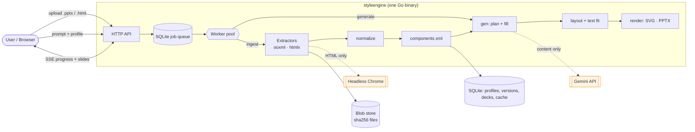
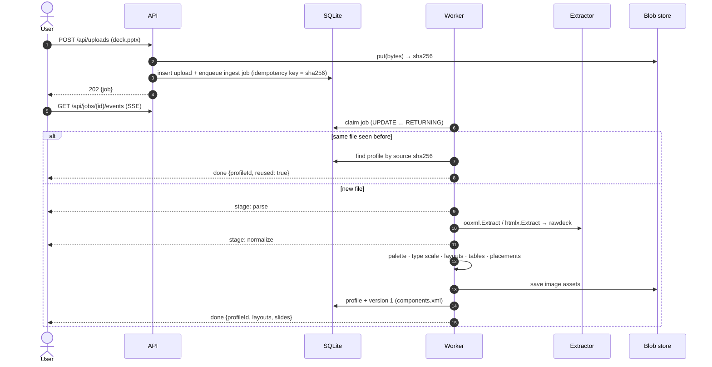
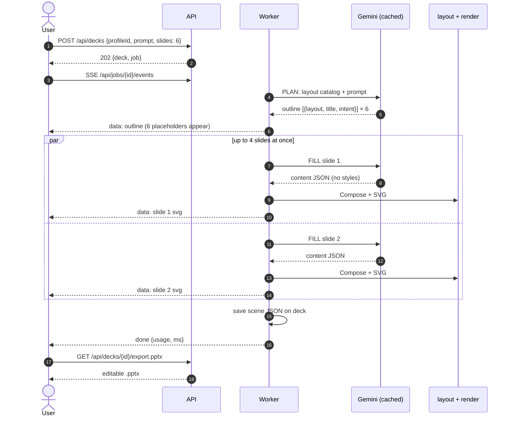
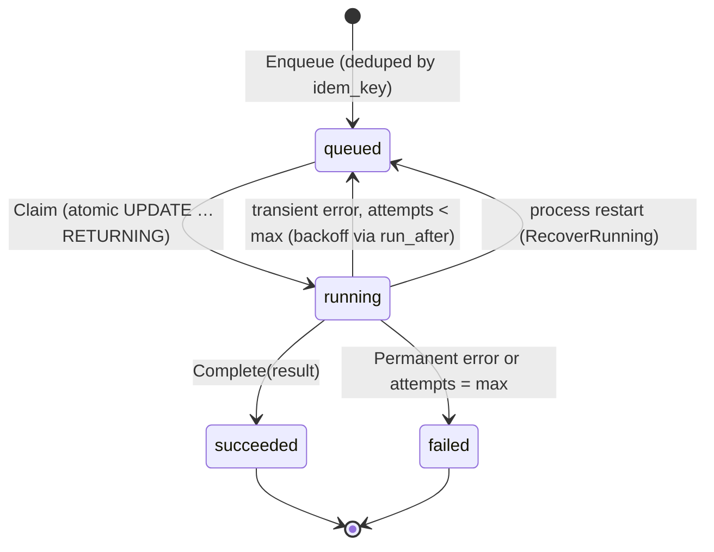
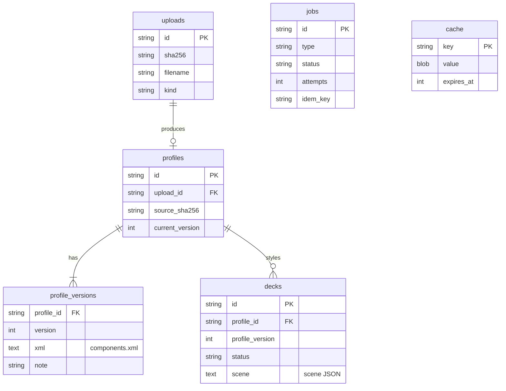
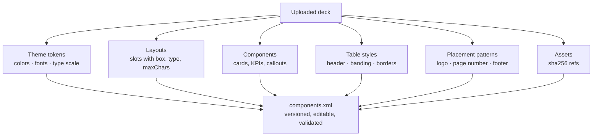

# Style Engine: Design Plan

Extract a reusable design system from PPTX/HTML decks (`components.xml`) and generate new decks in that style at low LLM cost.

> Status: v1 targets a **single Go binary** on **SQLite**. Postgres is supported later through the `store.Store` interface. Section 9 tracks what was simplified from the original "scale-out" design and how to grow back into it.

## Contents

- [Visual guide](#visual-guide): system map, upload flow, generation flow, job states, data model, timing, UI mockups
- [1. Summary](#1-summary) · [3. Architecture](#3-architecture-v1) · [4. components.xml](#4-the-style-profile-componentsxml) · [6. Generation](#6-generation-where-llm-cost-is-controlled) · [7. Latency](#7-latency-targets-single-box-initial) · [8. API](#8-api-v1)

## Visual guide

Diagrams render natively on GitHub. Click a ▸ heading to expand it.

### System map



Gemini (orange) is the only paid external call, and it only appears on the generation path. Extraction never calls an LLM.

<details>
<summary><b>▸ Upload → components.xml (sequence)</b></summary>


</details>

<details>
<summary><b>▸ Prompt → deck (sequence, with parallel fill)</b></summary>



The LLM receives only the layout catalog (slot names, types, char limits). Colors, fonts and coordinates are applied in Go after the response arrives.
</details>

<details>
<summary><b>▸ Job lifecycle (state diagram)</b></summary>


</details>

<details>
<summary><b>▸ Data model (SQLite)</b></summary>


</details>

<details>
<summary><b>▸ Timing: where the milliseconds go</b></summary>

Measured locally on the sample fixtures (single run, not a benchmark): PPTX extract ≈ 12 ms (9 slides), HTML extract ≈ 330 ms (6 slides, including Chrome start). The generation bars are **targets**, not measurements; Gemini latency has not been measured yet.

```mermaid
gantt
    title Generate 6 slides with Gemini (target, ms)
    dateFormat x
    axisFormat %L ms
    section Request
    Enqueue + SSE connect     :a1, 0, 20
    section Plan
    Gemini plan call          :a2, after a1, 900
    section Fill (4 parallel)
    Slide 1                   :b1, after a2, 700
    Slide 2                   :b2, after a2, 750
    Slide 3                   :b3, after a2, 650
    Slide 4                   :b4, after a2, 800
    Slide 5                   :b5, after b3, 700
    Slide 6                   :b6, after b1, 700
    section Go (per slide)
    Compose + SVG             :c1, after b6, 5
    Save scene                :c2, after c1, 5
```



| Step | Who | Target |
|---|---|---|
| PPTX → components.xml | Go only | < 1 s for 30 slides (measured ≈ 12 ms for 9) |
| HTML → components.xml | Go + Chrome | < 6 s for 30 slides (measured ≈ 330 ms for 6) |
| First slide on screen | Gemini plan + 1 fill | < 2 s |
| Compose + SVG per slide | Go only | < 10 ms |
| Export .pptx | Go only | < 100 ms |
| Repeat identical request | LLM cache hit | no Gemini call |
</details>

<details>
<summary><b>▸ UI mockups (embedded web UI)</b></summary>

**1. Upload and review the extracted style**

```text
┌──────────────────────┬─────────────────────────────────────────────────────────────┐
│ Style Engine         │  Acme Brand   [v1] [16:9 · pptx]   [ components.xml ]        │
│ ┌──────────────────┐ │                                                              │
│ │ Drop a .pptx or  │ │  Colors                                                      │
│ │ .html deck       │ │  ███ ███ ███ ███ ███ ███                                     │
│ └──────────────────┘ │  dk1 lt1 acc1 acc2 acc3 acc4                                 │
│ Extracted in 41 ms   │                                                              │
│                      │  Typography                                                  │
│ PROFILES             │  heading: Montserrat   body: Open Sans                       │
│ ▸ Acme Brand  pptx v1│  display 44pt · h1 32pt · body 18pt · caption 12pt           │
│   Nimbus      html v1│                                                              │
│                      │  Layouts (4)                                                 │
│                      │  ┌────────┐ ┌────────┐ ┌────────┐ ┌────────┐                  │
│                      │  │ TITLE  │ │ ▪ text │ │ ▢ ▢ ▢  │ │ ▤ table│                  │
│                      │  └────────┘ └────────┘ └────────┘ └────────┘                  │
│                      │  L1 title   L2 content L3 data   L4 data                      │
└──────────────────────┴─────────────────────────────────────────────────────────────┘
```

**2. Generate in that style (slides stream in as they finish)**

```text
┌─────────────────────────────────────────────────────────────────────────────┐
│ Generate a deck in this style                                               │
│ ┌─────────────────────────────────────────────────────────────────────────┐ │
│ │ Quarterly business review for a B2B SaaS company: growth, churn, ...    │ │
│ └─────────────────────────────────────────────────────────────────────────┘ │
│ Slides [ 6 ]  [ Generate ]                                                  │
│                                                                             │
│ "Q3 Business Review" – writing 6 slides…                                    │
│ ┌──────────┐ ┌──────────┐ ┌──────────┐ ┌──────────┐ ┌──────────┐ ┌────────┐ │
│ │ ✓ slide1 │ │ ✓ slide2 │ │ ✓ slide3 │ │ … slide4 │ │ … slide5 │ │ …      │ │
│ └──────────┘ └──────────┘ └──────────┘ └──────────┘ └──────────┘ └────────┘ │
│                                                                             │
│ 6 slides in 2.1 s (first slide 1.4 s) · tokens in 3.2k / out 1.9k           │
│ [ Download PPTX ]                                                           │
└─────────────────────────────────────────────────────────────────────────────┘
```

Figures in the mockups are illustrative.
</details>

<details>
<summary><b>▸ What goes into components.xml (annotated)</b></summary>



Editing: `PUT /api/profiles/{id}/components.xml` validates the XML and stores it as a new version. Older versions stay readable, and existing decks keep the version they were generated with.
</details>

### Try it in 60 seconds

- [ ] `go run ./cmd/styleengine serve -addr :8080 -data ./data`
- [ ] Open `http://localhost:8080` and drop `testdata/acme.pptx`
- [ ] Check the palette, fonts and layout previews, then open `components.xml`
- [ ] Enter a prompt and click **Generate** (offline writer unless `GEMINI_API_KEY` is set)
- [ ] Click **Download PPTX** and open it in PowerPoint, Keynote or Google Slides

> The UI, generation and `.pptx` export ship in [PR #2](https://github.com/ashutoshm97/curly-engine/pull/2). On this branch alone, the extraction API and CLI are available.

---

## 1. Summary

- **Style extraction uses no LLM.** A `.pptx` file is zipped OOXML, and an HTML deck can be measured in a headless browser. Both paths produce a normalized **Style Profile** (`components.xml`) holding theme tokens, a type scale, layouts with semantic slots, components, table styles, and recurring placement patterns. Extraction makes no LLM calls.
- **Generation uses a small LLM call.** Gemini never sees styling. It gets a compact catalog of layouts and slots and returns **content-only JSON**. A deterministic Go layout engine binds content to slots, fits text using font metrics, and renders the deck to PPTX, SVG/HTML, or scene JSON.
- **The whole system is one Go binary.** It contains the HTTP API, the SQLite store and job queue, the blob store, the workers, and the embedded web UI. `styleengine serve` is all you run.

## 2. Goals / Non-goals

| Goals | Non-goals (v1) |
|---|---|
| Ingest `.pptx` / `.potx` and `.html` decks | Pixel-perfect PPTX round-trip (SmartArt, animations, 3D) |
| Extract theme, type scale, layouts, components, tables, placements into a versioned profile | PDF / image-only decks (needs vision; possible Phase 3 fallback) |
| Generate new decks "in the style of" a profile from a prompt/outline | Real-time co-editing |
| Low latency, many concurrent users on one box | Horizontal scale-out (see §9) |
| LLM optional except for writing content; works offline with a heuristic provider | |

## 3. Architecture (v1)

```
Browser (embedded UI: upload, review profile, generate, preview, export)
   │ HTTP/JSON + SSE
   ▼
┌───────────────────────────── styleengine (single Go binary) ─────────────────────────────┐
│  api (net/http, Go 1.22 routing)  ──  SSE broker (in-process pub/sub)                    │
│        │                                                                                 │
│        ├─▶ store (SQLite via modernc.org/sqlite, WAL)                                    │
│        │     uploads · profiles · profile_versions · decks · jobs · cache               │
│        │                                                                                 │
│        ├─▶ jobs: SQLite-backed queue + goroutine worker pool                              │
│        │     ingest.pptx ─▶ ooxml ─┐                                                     │
│        │     ingest.html ─▶ htmlx ─┴▶ rawdeck ─▶ normalize ─▶ profile (components.xml)   │
│        │     generate    ─▶ gen (plan/fill via llm) ─▶ layout ─▶ render/{scene,svg,pptx} │
│        │                                                                                 │
│        ├─▶ blob: content-addressed files on disk (sha256)                                 │
│        └─▶ llm: Gemini (REST generateContent, JSON schema) | offline provider            │
│              + response cache (in-process LRU → SQLite cache table)                      │
└──────────────────────────────────────────────────────────────────────────────────────────┘
                     htmlx drives headless Chrome via chromedp (only for HTML ingest)
```

### Technology choices

| Concern | Choice | Reason |
|---|---|---|
| Language | Go | Goroutine fan-out across slides and elements; `archive/zip` and `encoding/xml` are in the standard library; single static binary |
| HTTP | `net/http` (Go 1.22 pattern routing) | No framework needed |
| Database | **SQLite** (`modernc.org/sqlite`, pure Go, no cgo), WAL mode | Zero-ops. Concurrent readers, one writer, which is ample for this workload. Postgres can be added behind the same `store.Store` interface. |
| Cache (Redis replacement) | In-process LRU (`hashicorp/golang-lru`) in front of a SQLite `cache` table | Hot profiles and LLM responses survive restarts without Redis |
| Job queue (NATS replacement) | `jobs` table + atomic claim (`UPDATE … RETURNING`) + worker pool; in-process notify for instant wake-up | At-least-once delivery, idempotency key, retries; no broker to run |
| Blob store (S3 replacement) | `data/blobs/<sha256[:2]>/<sha256>` | Dedupes logos and images that repeat across decks |
| HTML extraction | `chromedp` + headless Chrome | Only a real browser gives correct computed CSS and layout boxes |
| LLM | **Google Gemini** (`gemini-2.5-flash` by default; plan/fill models configurable), JSON-schema output, thinking budget 0 | Low latency and cost; implicit prefix caching applies because the static catalog goes first in the prompt |
| Text metrics | `golang.org/x/image/font/opentype` with Go fonts as metric fallbacks | Deterministic text fitting without a browser |
| UI | Static HTML/JS embedded with `embed`, SVG rendering | Nothing extra to build or deploy |

## 4. The Style Profile (`components.xml`)

Design rules:

1. **Normalized geometry.** Every box is `x y w h` in slide fractions (0–1), snapped to a 0.005 grid.
2. **Token indirection.** Components and slots reference color tokens (`accent1`, `dk1`, derived `accent1-tint40`) and font roles (`heading`, `body`). Re-theming means swapping tokens.
3. **Layouts expose slots, not shapes.** A slot is a semantic hole (`title`, `body`, `image`, `table`, `chart`) with capacity (`maxChars`) and a shrink floor (`minStep`). Repeated card groups become `repeat` regions.
4. **Provenance.** `freq` and `sourceSlides` on each layout; `support` on placements.
5. **Versioned.** Profile id + version + `sha256(source)`. Re-uploading the same file returns the existing profile.

Storage: canonical **XML** (`components.xml`) is the editable artifact. Each version is parsed once, validated (`profile.Validate()` checks the XSD-equivalent referential rules), and the compiled struct is cached in-process. The generation hot path never re-parses XML.

Abridged example:

```xml
<styleProfile id="sp_…" version="1" schemaVersion="1.0" source="sha256:…" sourceType="pptx" aspect="16:9" widthPt="960" heightPt="540">
  <tokens>
    <colors>
      <color name="dk1" value="#1A1A2E"/><color name="lt1" value="#FFFFFF"/>
      <color name="accent1" value="#E94560"/><color name="accent2" value="#0F3460"/>
    </colors>
    <fonts><font role="heading" family="Montserrat" fallback="Arial"/><font role="body" family="Inter" fallback="Arial"/></fonts>
    <typeScale unit="pt">
      <step name="display" size="44" lineHeight="1.1"/><step name="h1" size="36" lineHeight="1.15"/>
      <step name="h2" size="40" lineHeight="1.2"/><step name="body" size="18" lineHeight="1.3"/>
      <step name="caption" size="12" lineHeight="1.3"/>
    </typeScale>
    <spacing unit="frac" grid="12" gutter="0.02" margin="0.06 0.06 0.08 0.06"/>
  </tokens>
  <components>
    <component id="C.title" type="text" role="title"><text font="heading" step="h1" color="dk1" align="l" bold="true"/></component>
    <component id="C.body" type="list" role="body"><text font="body" step="body" color="dk1"/><marker glyph="•"/></component>
    <component id="C.card" type="group" role="card">
      <shape kind="roundRect" fill="c1" radius="8"/>
      <slot name="value" box="0.1 0.13 0.8 0.4"><text font="body" step="h2" color="accent1" bold="true"/></slot>
      <slot name="label" box="0.1 0.6 0.8 0.27"><text font="body" step="caption" color="accent6"/></slot>
    </component>
  </components>
  <tables>
    <tableStyle id="T1"><header fill="accent2" text="lt1" bold="true" step="caption"/><body fill="lt1" bandRows="true" bandFill="lt2" text="dk1" step="caption"/></tableStyle>
  </tables>
  <layouts>
    <layout id="L2" name="Title + text left, image right" kind="content" freq="0.33" sourceSlides="2,4,7">
      <slot name="title" type="text" component="C.title" box="0.06 0.06 0.88 0.12" maxChars="70"/>
      <slot name="body" type="list" component="C.body" box="0.06 0.22 0.42 0.64" maxChars="520" minStep="caption"/>
      <slot name="image" type="image" box="0.52 0.22 0.42 0.64"/>
      <decor kind="image" role="logo" box="0.86 0.89 0.1 0.07" asset="A1"/>
    </layout>
    <layout id="L3" name="Title + 3-4 cards" kind="data" freq="0.22">
      <slot name="title" type="text" component="C.title" box="0.06 0.06 0.88 0.12"/>
      <repeat name="items" component="C.card" min="2" max="4" region="0.06 0.32 0.88 0.3" direction="row" gap="0.02"/>
    </layout>
  </layouts>
  <patterns>
    <placement element="logo" anchor="br" box="0.86 0.89 0.1 0.07" support="1" asset="A1"/>
    <placement element="pageNumber" anchor="bl" box="0.05 0.91 0.1 0.05" support="1"/>
    <sequence>L1 → (L2 | L3 | L4)* → L1</sequence>
  </patterns>
  <assets><asset id="A1" ref="&lt;sha256&gt;" kind="image" mime="image/png"/></assets>
</styleProfile>
```

## 5. Ingestion (no LLM)

### 5.1 PPTX (`internal/ooxml`)

1. **Validate.** Zip limits (entry count, total uncompressed size, per-entry ratio) and max slide count. Go's `encoding/xml` does not resolve external entities, so XXE is not an issue.
2. **Read in order.** `presentation.xml` (slide size, slide order) → master (`clrMap`, placeholders, `txStyles`, decor) → theme (`clrScheme`, `fontScheme`) → layouts → slides.
3. **Inheritance.** Box: slide shape → layout placeholder (by `idx`, then type) → master placeholder. Text style: run `rPr` → shape `lstStyle` → layout placeholder → master placeholder → master `txStyles`. Colors resolve `schemeClr` through `clrMap`, including `lumMod`/`lumOff`/`tint`/`shade`.
4. **Elements.** Shapes, text, pictures (bytes become content-addressed assets), group transforms, tables (`tableStyles.xml` + built-in style fallbacks + per-cell overrides), and charts. Master and layout decor is attached to each slide as `inherited`.

### 5.2 HTML (`internal/htmlx`)

A headless Chrome tab per job with outbound network blocked and a 1280×720 viewport. Slides are detected with framework adapters (reveal.js `section`, `.slide`, `[data-slide]`), falling back to full-viewport siblings. One injected JS pass per slide returns bounding boxes and computed styles. The output is the same `rawdeck.Deck`, so everything downstream is shared with the PPTX path.

### 5.3 Normalize (`internal/normalize`)

| Task | Approach |
|---|---|
| Color tokens | PPTX: theme slots. HTML: area/char-weighted color buckets merged in CIELAB (ΔE<8). Roles are assigned by usage (lt1 = dominant light background, dk1 = dominant dark text, accents = saturated colors by weight). |
| Type scale | Per-role font-size modes → `display / h1 / h2 / body / caption` |
| Roles | Placeholders are authoritative. Otherwise geometric rules: large text near the top = title; short text in the bottom band = footer/page number; small corner image = logo. |
| Cards | A filled shape that contains text elements becomes a card. ≥2 similar cards aligned in a row become a `repeat` region. |
| Layout discovery | Each slide is a set of (role, box) pairs. Distance = 1 − greedy role-matched IoU. Greedy clustering with a threshold; the medoid gives slot boxes (averaged across members); `freq` = share of slides. |
| Placements | Logo / page number / footer / decor recurring at the same box in ≥50% of slides |
| Sequence | Layout transition counts plus a compact flow string |

## 6. Generation (where LLM cost is controlled)

```
brief/outline ─▶ PLAN (1 Gemini call)  in: brief + layout catalog (~0.5k tok)   out: [{layout, intent}]
             ─▶ FILL (1 call/slide, parallel, streamed via SSE)  in: intent + slot schema  out: slot JSON
             ─▶ LAYOUT (Go, deterministic)  bind slots → boxes; measure text; shrink down to minStep; truncate as last resort
             ─▶ RENDER  scene JSON (UI) · SVG/HTML preview · editable PPTX (theme + slides) 
```

Cost levers:
- Styles never go to the LLM.
- JSON-schema-constrained output means short responses and no parse retries.
- Small, fast model with thinking disabled.
- The static prefix goes first so Gemini's implicit caching can apply.
- Responses are cached by `hash(model, prompt)` in LRU + SQLite.
- Single-slide regeneration costs one small call.
- An offline heuristic provider handles development and fallback.

Estimated tokens for a 10-slide deck: ≈3–4k input + ≈2k output. These are estimates; verify against current Gemini pricing.

## 7. Latency targets (single box, initial)

| Operation | Target p50 |
|---|---|
| PPTX ingest, 30 slides | < 1 s |
| HTML ingest, 30 slides (warm Chrome) | < 6 s |
| Generate: first slide streamed | < 2 s with Gemini; < 50 ms offline |
| PPTX export, 10 slides | < 100 ms |

Techniques:
- Per-slide goroutines.
- Compiled-profile LRU.
- SSE streaming of each slide as soon as it is laid out.
- Content-hash dedupe of uploads and assets.
- SQLite in WAL mode with a busy timeout.

## 8. API (v1)

| Method & path | Purpose |
|---|---|
| `POST /api/uploads` (multipart `file`) | Store the blob and enqueue `ingest`. Idempotent per file hash. |
| `GET /api/jobs/{id}` · `GET /api/jobs/{id}/events` | Job status · SSE progress |
| `GET /api/profiles` · `GET /api/profiles/{id}` | List · profile JSON |
| `GET/PUT /api/profiles/{id}/components.xml` | Download · edit (creates a new version) |
| `GET /api/profiles/{id}/preview` | Every layout rendered with sample content (SVG) |
| `POST /api/decks` | Generate a deck `{profileId, prompt, outline, slides}` and return a job |
| `GET /api/decks/{id}` · `/preview` · `/export.pptx` | Scene JSON · HTML preview · editable PPTX |

CLI: `styleengine serve`, `styleengine extract <file> [-o components.xml]`, `styleengine generate -profile components.xml -prompt "…" -o deck.pptx`.

## 9. Simplifications vs. the scale-out design, and the path back

| v1 (simple) | Scale-out replacement | Seam |
|---|---|---|
| SQLite | Postgres (+ `pgvector` for layout search) | `store.Store` interface |
| SQLite job table + worker pool | NATS JetStream / Postgres `SKIP LOCKED` | `jobs.Queue` |
| In-process LRU + SQLite cache table | Shared cache (Postgres table or Redis) | `llm.Cache` |
| Local disk blobs | S3 / GCS | `blob.Store` |
| In-process SSE broker | NATS subjects / Postgres `LISTEN/NOTIFY` | `api.Broker` |
| Embedded UI | Next.js app with a canvas editor | HTTP API unchanged |

## 10. Security

- Upload size limit.
- Zip-bomb guards; macros are never executed and embedded OLE objects are ignored.
- HTML is loaded with outbound requests blocked and a per-job timeout.
- Only user-supplied content is sent to Gemini, never raw files.
- The API key comes from the environment (`GEMINI_API_KEY`) and is never logged.

## 11. Roadmap

| Phase | Scope |
|---|---|
| **1 (this repo)** | PPTX + HTML extraction → `components.xml`; SQLite store/queue; Gemini plan/fill; layout/text-fit; PPTX/SVG export; embedded UI |
| 2 | Profile review editing in the UI (merge/rename layouts, token editor); charts; image generation/search for image slots; font upload |
| 3 | Postgres + object storage + external queue for multi-node; per-tenant auth and quotas; learned role classifier from user edits; PDF/image ingest via Gemini vision (fallback only) |

## 12. Risks

| Risk | Mitigation |
|---|---|
| OOXML inheritance edge cases | Golden tests on real decks; fixture generator in `testdata/` |
| Missing fonts → metric mismatch | Fallback metrics plus conservative fit margins; font upload later |
| JS-heavy HTML decks | Framework adapters, wait-for-idle, timeout |
| Text overflow | Shrink to `minStep`, then truncate (the LLM can be asked to shorten as a last resort) |
